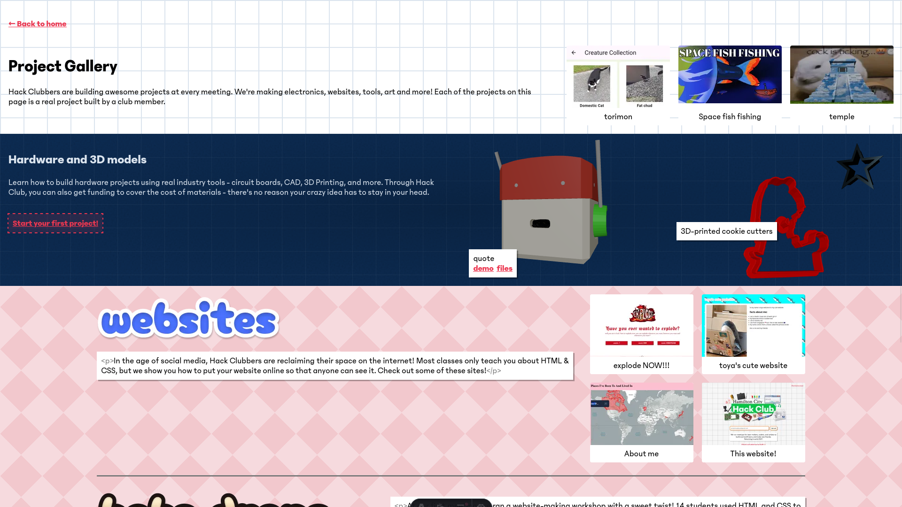

# hackwaikato.org

This is the code for the Hamilton City Hack Club website, which is built using [Astro](https://astro.dev) and available at [hackwaikato.org](https://hackwaikato.org). 3D models on the gallery page are made using [Three.js](https://threejs.org/). Pull requests or other contributions welcome!



## Project Structure

```text
/
├── public/ <- Files that need a known location
|   ├── robots.txt
│   └── favicon.svg
├── src
│   ├── assets <- Asset files that can be compressed
│   │   └── Fonts, Images, etc
│   ├── components <- Reusable HTML components
│   │   └── Signup.astro
│   ├── layouts <- Page layouts
│   |   ├── Base.astro <- Layout all pages use (has useful metadata)
│   │   └── Layout.astro <- Layout for index page.
│   └── pages <- Files that need a known location
|       ├── gallery.astro
|       ├── members.astro
│       └── index.astro
└── package.json
```

To learn more about the folder structure of an Astro project, refer to [the guide on project structure](https://docs.astro.build/en/basics/project-structure/).

## Dev Commands

You will need [NodeJS](https://nodejs.org/en/download) to run these! All commands are run from the root of the project, from a terminal:

| Command                   | Action                                           |
| :------------------------ | :----------------------------------------------- |
| `npm install`             | Installs dependencies                            |
| `npm run dev`             | Starts local dev server at `localhost:4321`      |
| `npm run build`           | Build your production site to `./dist/`          |
| `npm run preview`         | Preview your build locally, before deploying     |
| `npm run astro ...`       | Run CLI commands like `astro add`, `astro check` |
| `npm run astro -- --help` | Get help using the Astro CLI                     |
